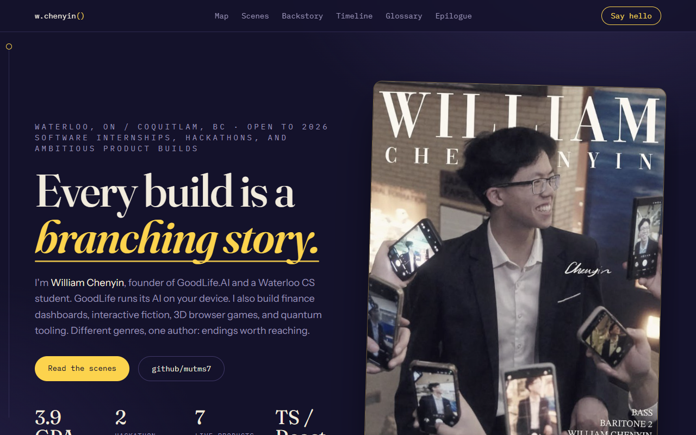
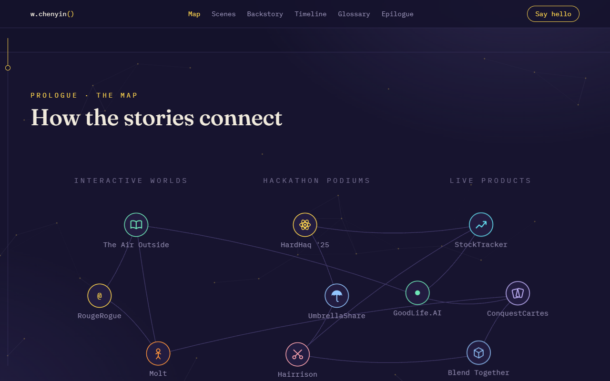
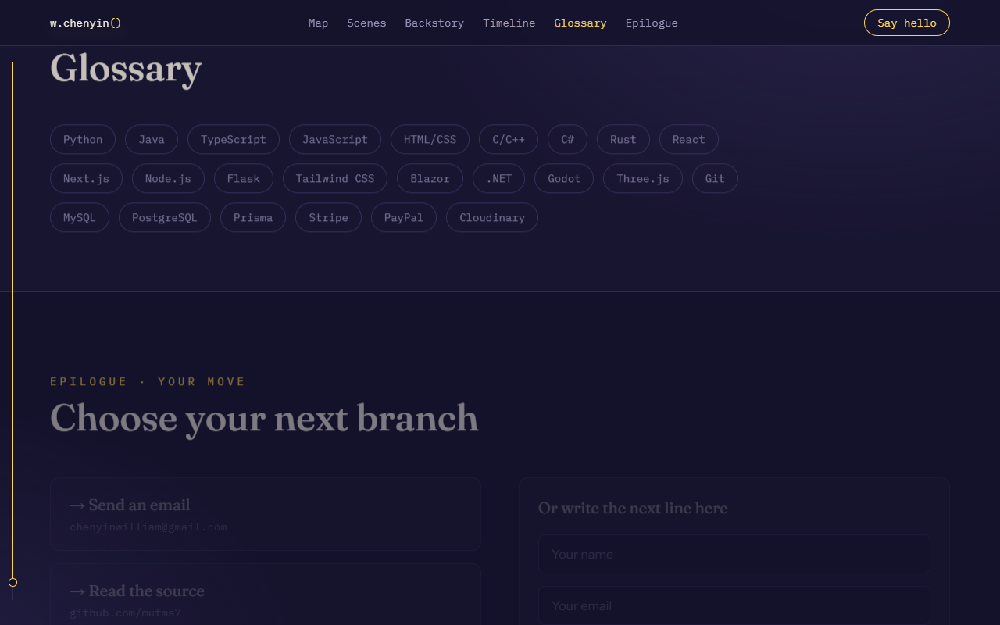

# William Chenyin Personal Portfolio

A portfolio built as a story system: an interactive SVG story graph for a hero, projects framed as scenes, and a visual-novel epilogue for contact. Built with React, TypeScript, Tailwind CSS, and Vite.

**Live Site:** [william-chenyin.vercel.app](https://william-chenyin.vercel.app/)







## Highlights

- Hand-coded SVG constellations across a faint open book, with four labeled themes and a reduced set of project relationships. Every project has its own symbol; mouse hover and keyboard focus explain connections, and selecting a project opens its scene. Phones and tablets use grouped project controls.
- Editorial "scene" layout for projects with consistent metadata, technology tags, links, and per-project accent colors. EastEats, Typer.AI, SlimWaste, and GoodLife.AI appear first, with a More projects button for the rest. Story-map selections and direct links reveal older projects automatically.
- Fraunces headings, Instrument Sans body text, and IBM Plex Sans labels on a deep indigo palette.
- Backstory, timeline, glossary (skills), and an epilogue contact section styled as dialogue choices.
- Contact form with Vercel serverless forwarding plus a Formspree fallback; reduced-motion and keyboard-focus support throughout.

## Quick Start

```bash
npm install
npm run dev
npm run build
```

## Useful Scripts

```bash
npm run dev        # Start the local Vite server
npm run build      # Build the production bundle
npm run preview    # Preview the production build
npm run typecheck  # Run TypeScript checks
```
